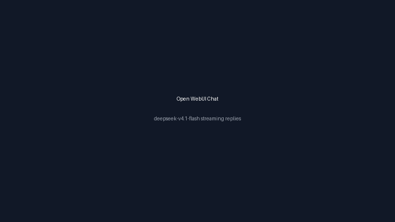
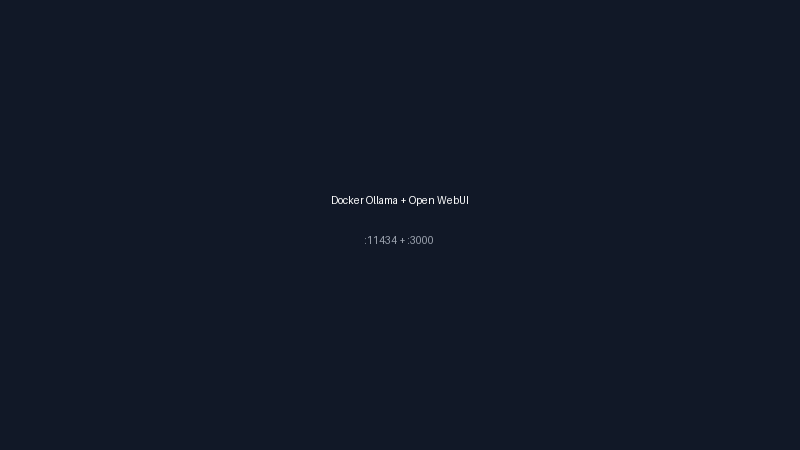
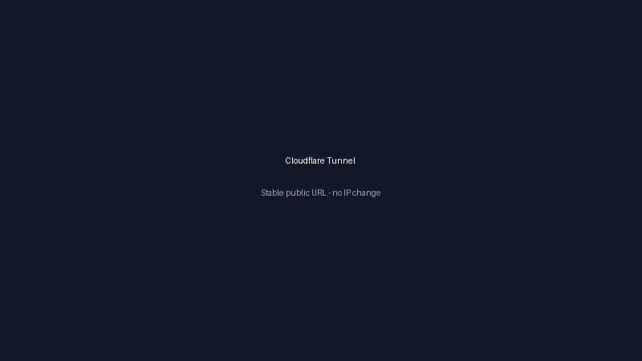

<div align="center">


# DeepSeek Free — v4.1 Flash & Coder

**A free, lifetime, self-hosted AI stack: Ollama + Open WebUI + Cloudflare Tunnel + R2 backup.
Works on an 8 GB laptop or the Oracle Always Free VM. Optional high-end local mode for the real 552B DeepSeek-V4.1-Flash. Zero investment, copy-paste only.**

[](https://github.com/iamtanzir/DeepSeek-v4-1-Flash-Free)
[](https://github.com/iamtanzir/DeepSeek-v4-1-Flash-Free/releases)
[](./LICENSE)
[](#-quick-start)
[](#-cost--limits)

[**📘 বাংলা গাইড**](./docs/SETUP-BANGLA.md) · [**📄 Word**](./DeepSeek-V4.1-Flash_Free_Lifetime_Setup_Bangla_Guide.docx) · [**🐞 Report a bug**](https://github.com/iamtanzir/DeepSeek-v4-1-Flash-Free/issues) · [**💖 Support**](https://www.supportkori.com/tanzirahmed)

</div>

---

## ⚠️ Read this before you download 400 GB

DeepSeek-V4.1-Flash is a **552B-parameter Mixture-of-Experts model** (763B total
weights, 8B active per token). It is not a 24 GB model.

| Build | Download size | Minimum unified RAM/VRAM |
|---|---|---|
| `UD-IQ1_M` | **~259 GB** | **288 GB** |
| `Q4_K_M` | **~414 GB** | 448 GB |
| `MXFP4` | **~708 GB** | 768 GB |

The old version of this repo told people to run `ollama pull deepseek-v4.1-flash`
on a 24 GB Oracle VM. That never worked: Ollama only publishes `:cloud` tags for
that model, and no free VM can hold the weights. This version fixes that.

**What the free tier actually runs:** `deepseek-r1:8b` (DeepSeek's official
open reasoning model, ~5.2 GB, 8 GB RAM). It is excellent for chat, reasoning,
Bangla/English, and code. If you want the exact V4.1-Flash model, use the
**flagship local** mode on a workstation or the **API** mode on any device.

---

## 🖼️ Preview

<table>
  <tr>
    <td align="center" width="34%"><br/><sub><b>Chat</b> — Open WebUI streaming replies</sub></td>
    <td align="center" width="34%"><br/><sub><b>Docker</b> — Ollama :11434 + WebUI :3000</sub></td>
    <td align="center" width="34%"><br/><sub><b>Tunnel</b> — stable public URL, no open ports</sub></td>
  </tr>
</table>

---

## 🎯 Choose your path

| | Path A — Free forever | Path B — High-end local | Path C — Real model, no hardware |
|---|---|---|---|
| **Model** | `deepseek-r1:8b` / `deepseek-coder:6.7b-instruct` | `DeepSeek-V4.1-Flash` IQ1_M/Q4 | `DeepSeek-V4.1-Flash` via API |
| **Hardware** | 8 GB RAM, any VPS, Oracle Free | 288 GB+ RAM/VRAM | any phone/laptop |
| **Cost** | $0 | hardware only | per-token (cheap) |
| **Setup** | `./scripts/setup.sh` | `./scripts/local-setup.sh --mode flagship --gpu` | `./scripts/setup.sh --mode api` |
| **Lifetime** | ✅ | ✅ | as long as you keep the key |

---

## ⚡ Quick start

### Path A — Free forever (recommended for everyone)

On any Ubuntu 22.04/24.04 VM (Oracle Always Free, Hostinger, Contabo, Hetzner,
DigitalOcean…) or Linux home server:

```bash
git clone https://github.com/iamtanzir/DeepSeek-v4-1-Flash-Free.git
cd DeepSeek-v4-1-Flash-Free
chmod +x scripts/*.sh
./scripts/setup.sh
```

The installer:

1. installs Docker Engine if missing (Linux),
2. starts Ollama + Open WebUI,
3. pulls `deepseek-r1:8b`,
4. generates a stable `WEBUI_SECRET_KEY`,
5. waits for both health checks,
6. prints the URLs.

Open **http://YOUR_VM_IP:3000**, register the admin account immediately, pick
`deepseek-r1:8b`, chat.

> On a 4 GB machine: `./scripts/setup.sh --mode nano` (1.5B, ~1.1 GB).

### Path B — High-end local PC / workstation

Windows (Docker Desktop + WSL2):

```powershell
git clone https://github.com/iamtanzir/DeepSeek-v4-1-Flash-Free.git
cd DeepSeek-v4-1-Flash-Free
.\scripts\local-setup.ps1              # lite model, local tuning
.\scripts\local-setup.ps1 -Gpu         # + NVIDIA GPU reservation
.\scripts\local-setup.ps1 -Mode flagship -Gpu   # real V4.1-Flash, 288 GB+
```

Linux / macOS:

```bash
chmod +x scripts/*.sh
./scripts/local-setup.sh               # lite model, local tuning
./scripts/local-setup.sh --gpu         # + NVIDIA GPU
./scripts/local-setup.sh --mode flagship --gpu  # real V4.1-Flash, 288 GB+
```

**Flagship hardware reality check**

| Setup | Fits |
|---|---|
| Mac Studio M3 Ultra 512 GB | IQ1_M / Q4 |
| Threadripper + 256 GB DDR5 + 2× RTX 6000 Ada | IQ1_M |
| 4× H100 80 GB (320 GB) | IQ1_M |
| 6× H100 80 GB (480 GB) | Q4 |
| Gaming laptop 16–24 GB VRAM | ❌ use lite or API |
| Oracle Always Free 24 GB | ❌ use lite |

On macOS, use the **native Ollama app** for Metal acceleration; Docker on macOS
has no GPU passthrough.

Local mode binds Open WebUI to `127.0.0.1` (this machine only). Set
`WEBUI_BIND=0.0.0.0` in `.env` if you want other devices on your LAN to connect.

The default flagship tag is the community IQ1_M build
`frob/deepseek-v4.1-flash:552b-a8b-1017-ud-iq1_M` (~259 GB). For the official
Unsloth GGUF at Q4 (~414 GB):

```bash
./scripts/setup.sh --mode flagship --local --gpu \
  --model hf.co/unsloth/DeepSeek-V4.1-Flash-1017-GGUF:UD-Q4_K_XL
```

### Path C — Real V4.1-Flash on any device (API)

```bash
cp .env.example .env
# edit .env:
#   ENABLE_OPENAI_API=true
#   OPENAI_API_BASE_URL=https://ollama.com/v1
#   OPENAI_API_KEY=your_key
./scripts/setup.sh --mode api
```

Works with any OpenAI-compatible endpoint: Ollama Cloud, DeepSeek API,
OpenRouter, LiteLLM, vLLM. This is the only way to use the 552B model without
288 GB of hardware.

---

## 🧩 Services

| Service | Default bind | URL | Auth |
|---|---|---|---|
| Open WebUI | `0.0.0.0:3000` | `http://localhost:3000` | ✅ accounts |
| Ollama API | `127.0.0.1:11434` | `http://127.0.0.1:11434/v1` | ❌ **never expose** |
| Cloudflare Tunnel | — | `https://ai.yourdomain.com` | Cloudflare Access |
| Cloudflare R2 | — | `r2:deepseek-backup` | private bucket |

Change ports in `.env` (`WEBUI_PORT`, `OLLAMA_PORT`). Keep `OLLAMA_BIND=127.0.0.1`.

---

## 🆓 Cost & limits

| Component | Cost | Notes |
|---|---|---|
| Oracle Cloud Always Free | $0 lifetime | Ampere 4 OCPU / 24 GB RAM; runs the 8B model |
| Ollama + Open WebUI | $0 | open source |
| Cloudflare Tunnel | $0 | stable public URL, no open ports |
| Cloudflare R2 | $0 for 10 GB | **cannot** hold the 259–414 GB flagship model |
| Flagship local | hardware only | 288 GB+ RAM/VRAM |

> **R2 warning:** 10 GB is enough for the lite/coder models and WebUI data.
> Back up the flagship model to an external disk/NAS instead
> (`./scripts/offline-download.sh`).

---

## 🔐 Cloudflare Tunnel — public URL

Quick tunnel (test, URL changes on restart):

```bash
cloudflared tunnel --url http://localhost:3000
```

Permanent (Zero Trust dashboard):

1. Cloudflare Dashboard → **Zero Trust → Networks → Tunnels → Create tunnel**
2. Name: `deepseek-tunnel` → copy the **token**
3. On the VM:

```bash
sudo cloudflared service install YOUR_TUNNEL_TOKEN
sudo systemctl enable --now cloudflared
```

4. Public Hostname: `ai.yourdomain.com` → `http://localhost:3000`

Locally-managed tunnel config: `configs/tunnel-ready.yml`.
Do **not** create a public hostname for port 11434.

---

## 💾 Backup & restore (R2)

```bash
# one-time: configure rclone
rclone config create r2 s3 provider=Cloudflare \
  access_key_id=... secret_access_key=... \
  endpoint=https://YOUR_ACCOUNT_ID.r2.cloudflarestorage.com acl=private

./scripts/backup-r2.sh --dry-run   # preview
./scripts/backup-r2.sh             # stops containers, copies, restarts
./scripts/restore-r2.sh --yes      # uses copy, never wipes local data
```

The backup stops the containers first so SQLite and the model store are
consistent. `restore-r2.sh` uses `rclone copy` (not `sync`), so an empty or
wrong remote cannot delete your files. Restore stops the containers; start them
again with `docker compose up -d` when it finishes.

Config reference: `configs/rclone-r2.conf.example`.

---

## 📴 Offline bundle (USB / no internet)

```bash
./scripts/offline-download.sh deepseek-r1:8b ./offline-models
# → offline-models/ollama-models-deepseek-r1_8b-YYYY-MM-DD.tar.gz
```

Restore anywhere:

```bash
tar -xzf ollama-models-*.tar.gz
docker compose up -d
```

The archive is a clean copy taken with the containers stopped. For the flagship
model the archive is 259–414 GB, so use a real external drive.

---

## 🧪 Google Colab — demo only

Colab free is **not** lifetime hosting: ~12 h max, idle disconnect, VM wiped.
The free T4 (16 GB) cannot load V4.1-Flash. The notebook runs `deepseek-r1:8b`.

Notebook: `colab/colab-setup.ipynb` · Guide: `colab/README.md`.

---

## 🖥️ Any VPS / home server

```bash
git clone https://github.com/iamtanzir/DeepSeek-v4-1-Flash-Free.git
cd DeepSeek-v4-1-Flash-Free
chmod +x scripts/*.sh
./scripts/vps-setup.sh
```

`vps-setup.sh` opens only SSH + the WebUI port in UFW. It deliberately does
**not** open 11434. For a home PC, use `./scripts/local-setup.sh`.

Nginx reverse proxy: `configs/nginx.conf.example` (WebUI only, WebSocket-ready).

---

## 🤖 API & OpenCode

```bash
curl http://127.0.0.1:11434/v1/chat/completions \
  -H "Content-Type: application/json" \
  -d '{"model":"deepseek-r1:8b","messages":[{"role":"user","content":"Hi"}]}'
```

OpenCode (local):

```json
{
  "$schema": "https://opencode.ai/config.json",
  "providers": {
    "ollama": { "settings": { "baseURL": "http://127.0.0.1:11434/v1" } }
  },
  "model": "ollama/deepseek-r1:8b"
}
```

OpenCode (Ollama Cloud / remote): `configs/opencode-cloud.json.example`.

Official links:

- https://www.deepseek.com/en/news/deepseek-v4-1-flash/
- https://huggingface.co/deepseek-ai/DeepSeek-V4.1-Flash
- https://ollama.com/library/deepseek-v4.1-flash
- https://ollama.com/library/deepseek-r1
- https://recipes.vllm.ai/deepseek-ai/DeepSeek-V4.1-Flash

---

## 💻 DeepSeek-Coder

```bash
./scripts/coder-setup.sh
# or: ./scripts/setup.sh --mode coder
```

Model: `deepseek-coder:6.7b-instruct` (~3.8 GB). Details:
`configs/deepseek-coder.md`.

---

## 🧱 Project structure

```text
DeepSeek-v4-1-Flash-Free/
├─ docker-compose.yml            # Ollama + Open WebUI (safe defaults)
├─ docker-compose.local.yml      # local high-end PC tuning
├─ docker-compose.gpu.yml        # NVIDIA GPU reservation
├─ .env.example                  # every option, documented
├─ install.sh / install.ps1      # thin one-command wrappers
├─ configs/
│  ├─ opencode.json.example      # OpenCode local
│  ├─ opencode-cloud.json.example
│  ├─ openwebui.env.example      # env-var reference
│  ├─ nginx.conf.example         # WebUI only, no Ollama proxy
│  ├─ tunnel-ready.yml
│  ├─ rclone-r2.conf.example
│  ├─ r2-ready.env.example
│  └─ deepseek-coder.md
├─ cloudflare/                   # tunnel guide + config example
├─ colab/                        # demo notebook (8B only)
├─ docs/
│  ├─ SETUP-FLASH.md
│  ├─ SETUP-CODER.md
│  └─ SETUP-BANGLA.md
└─ scripts/
   ├─ common.sh                  # shared helpers
   ├─ setup.sh / setup.ps1       # universal installer
   ├─ local-setup.sh / .ps1      # local high-end PC
   ├─ vps-setup.sh               # firewall + installer
   ├─ coder-setup.sh
   ├─ doctor.sh / doctor.ps1     # read-only diagnostics
   ├─ quick-test.sh              # end-to-end smoke test
   ├─ backup-r2.sh / restore-r2.sh
   ├─ offline-download.sh
   └─ push.sh
```

---

## 🔐 Security & privacy

- **Never expose port 11434.** Ollama has no authentication. The default bind is
  `127.0.0.1`; keep it.
- Open WebUI: create the admin account on first visit; set
  `DEFAULT_USER_ROLE=pending` (default) so new accounts need approval.
- Use Cloudflare Access in front of the public hostname for real privacy.
- R2 bucket stays **private**; never share object URLs.
- Set an OCI billing cap of $0 if you use Oracle.
- `.env` is git-ignored. Never commit API keys or `WEBUI_SECRET_KEY`.

---

## 🐞 Troubleshooting

| Symptom | Fix |
|---|---|
| `permission denied` on Docker | `sudo usermod -aG docker $USER`, log out/in. Scripts fall back to `sudo`. |
| `port 11434 already in use` | Stop host Ollama: `sudo systemctl stop ollama` (the stack uses Docker). |
| Model not in WebUI | `docker exec deepseek-ollama ollama list` then pull it: `docker exec deepseek-ollama ollama pull deepseek-r1:8b` |
| WebUI keeps logging out | `WEBUI_SECRET_KEY` is empty. Run `./scripts/setup.sh` again or set it in `.env`. |
| WebUI not healthy | `docker compose logs --tail 100 open-webui` |
| Ollama OOM on flagship | You do not have 288 GB. Use `--mode lite` or `--mode api`. |
| Tunnel 404 | Hostname must point to `http://localhost:3000`, not 11434. |
| R2 backup fails | Check `rclone lsd r2:deepseek-backup` and that the token has Object Read & Write. |
| Colab pull fails | Colab cannot run V4.1-Flash. Use `deepseek-r1:8b`. |
| Everything weird | `./scripts/doctor.sh` |

---

## 🗓️ Changelog

<details open>
<summary><b>v1.1.0 — current</b></summary>

**Correctness fixes**

- Removed the false "24 GB runs V4.1-Flash" claim. Documented real sizes
  (IQ1_M 259 GB, Q4 414 GB).
- `ollama pull deepseek-v4.1-flash` no longer used: Ollama only ships `:cloud`
  tags for it. Free tier now pulls `deepseek-r1:8b`; flagship uses IQ1_M/Q4.
- Fixed the R2 10 GB claim: it cannot hold the flagship model.
- Colab notebook no longer pulls a non-existent model or leaks a background
  process; runs an 8B model that fits a T4.

**Security fixes**

- Ollama is bound to `127.0.0.1` by default.
- `vps-setup.sh` no longer opens 11434 to the internet.
- Nginx no longer proxies the unauthenticated Ollama API.
- `DEFAULT_USER_ROLE=pending` so signups need admin approval.
- `WEBUI_SECRET_KEY` is generated and persisted.
- Local mode binds Open WebUI to `127.0.0.1` by default (LAN is opt-in).

**Reliability fixes**

- Health checks use `ollama list` and the WebUI `/health` endpoint.
- `.env` is actually wired into compose (ports, model, secret, API endpoint).
- `sg docker` removed; falls back to `sudo` correctly.
- `set -Eeuo pipefail` everywhere; no more silent failures.
- Backup stops containers for a consistent copy; restore uses `copy`, not
  `sync`, and never touches host paths.
- Offline script produces a real restorable archive.
- `quick-test.sh` and `doctor.sh` added.
- OpenCode config updated to the current `providers.settings` schema.
- Cloudflare config files use a valid `tunnel` UUID + `credentials-file`.
- Compose GPU/local overlays added; CRLF and `.gitignore` cleaned up.

</details>

<details>
<summary><b>v1.0.1</b></summary>

- Host vs container Ollama port conflict, restore guard, `sg docker`,
  arch-detect, CRLF fix.

</details>

<details>
<summary><b>v1.0.0</b></summary>

- Initial public release.

</details>

---

## 💖 Support the developer

<div align="center">

[](https://www.supportkori.com/tanzirahmed)

**DeepSeek Free by Tanzir Ahmed** · *Zero Investment • Lifetime Use*

</div>

---

## 🙏 Development credit & legal notice

- **Model:** © DeepSeek / @deepseek-ai — [`DeepSeek-V4.1-Flash`](https://huggingface.co/deepseek-ai/DeepSeek-V4.1-Flash) · [News](https://www.deepseek.com/en/news/deepseek-v4-1-flash/) · [Ollama](https://ollama.com/library/deepseek-v4.1-flash). Weights are **not** included or redistributed by this repo.
- **This repo (scripts/docs):** © Tanzir Ahmed — MIT (see `LICENSE`, `NOTICE.md`).
- **Others:** Ollama, Open WebUI, Cloudflare, Oracle — their own licenses/trademarks.
- **Copyright / ICT law:** downloads happen from official sources; no copied
  source, logo, or paywall bypass. Details: [`NOTICE.md`](./NOTICE.md).

---

## 📄 License

**MIT** — free to use, modify, and distribute.

<div align="center">

© 2026 Tanzir Ahmed — **DeepSeek Free**

[Repository](https://github.com/iamtanzir/DeepSeek-v4-1-Flash-Free) · [Issues](https://github.com/iamtanzir/DeepSeek-v4-1-Flash-Free/issues) · [Support](https://www.supportkori.com/tanzirahmed)

</div>
